#  PAMELA.DEV — Portfólio Profissional

> Laboratório 01 · DIAW (Desenvolvimento e Integração de Aplicações Web)
> Engenharia de Software · PUC Minas · Professor: João Paulo Carneiro Aramuni

🔗 **Site publicado:** https://portifolio-pamela.vercel.app/

---

## 📖 Sobre o projeto

Website de portfólio profissional para apresentar minha trajetória, habilidades, projetos e formas de contato. A identidade visual mistura **pixel art** e um **céu estrelado**, com a personagem **Luna**, criada por mim. O site tem tema claro/escuro e alternância de idioma entre **português e inglês**.

### Páginas e seções

| Rota | Conteúdo |
|---|---|
| `/` (Home) | Hero, **Sobre mim** resumido, **Projetos** em destaque, **Experiências**, **Habilidades** (globo 3D) e **Contato** |
| `/sobre` | Apresentação completa: formação, atividades, jornada tecnológica, idiomas e hobbies |
| `/projetos` | Galeria dos projetos, com tecnologias, link do GitHub e imagens/GIFs em funcionamento |
| `/experiencias` | Experiências profissionais, formação acadêmica e idiomas |

O menu fixo leva a cada seção: **Sobre · Projetos · Experiências · Habilidades · Contato**.

---

## 🖼️ Protótipos (wireframes de média fidelidade)

### Home

**Hero**
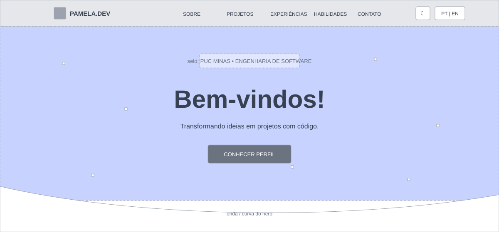

**Sobre mim (resumo)**
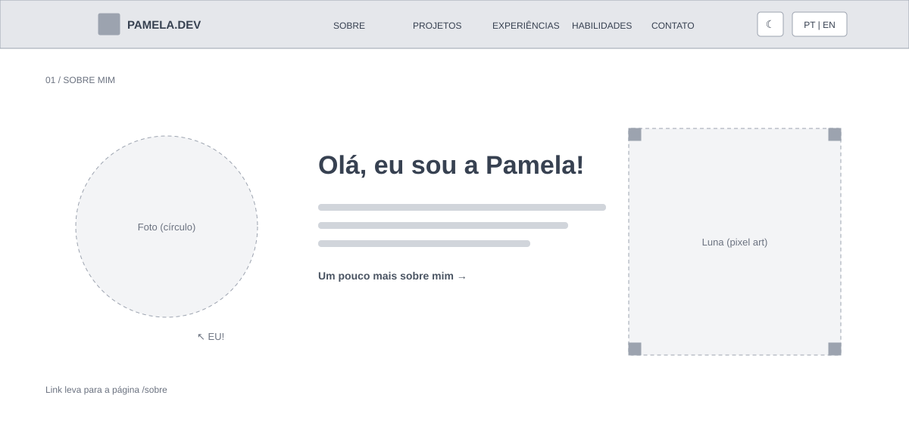

**Projetos em destaque**


**Experiências**
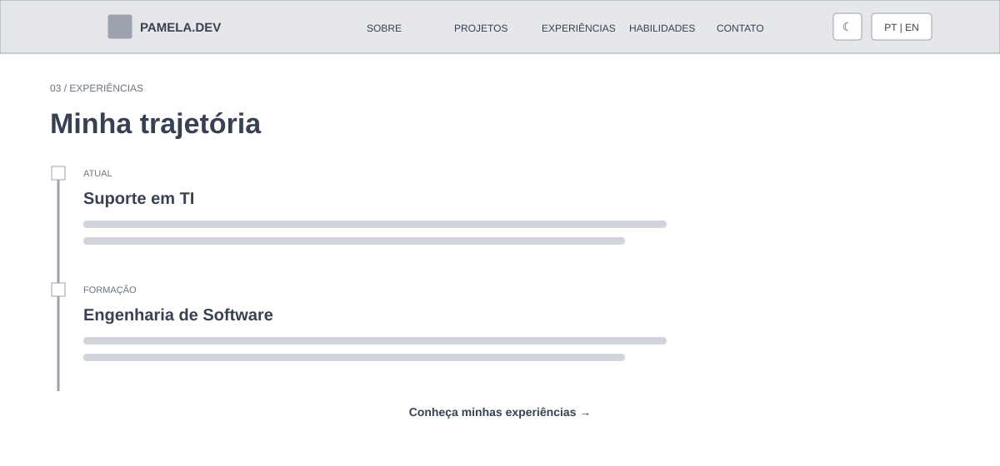

**Habilidades**
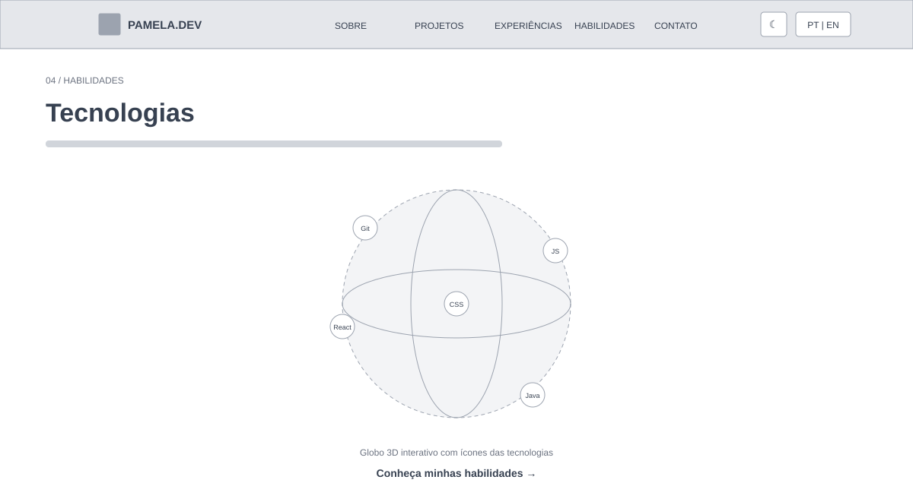

**Contato**
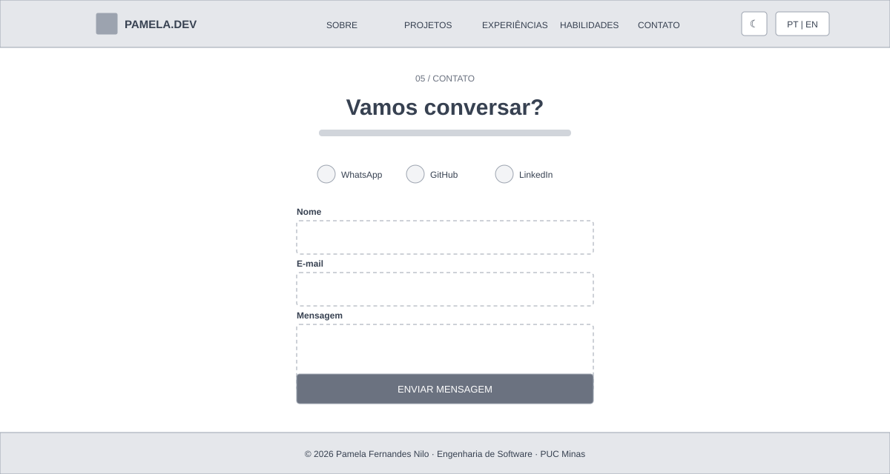

### Páginas internas

**/projetos**
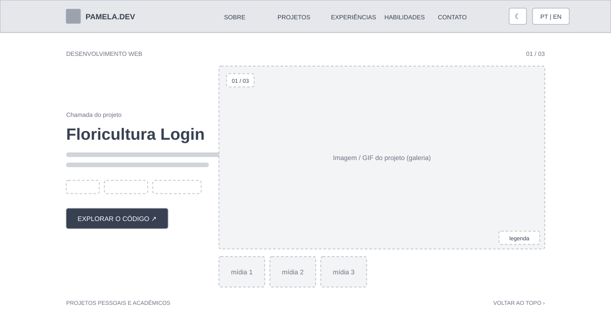

**/sobre**


**/experiencias**


---

## 📸 Telas do site publicado

### Home

**Hero**
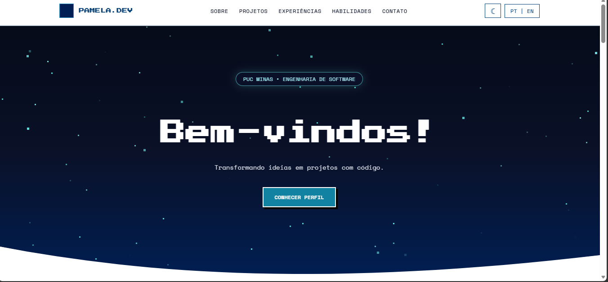

**Sobre mim**
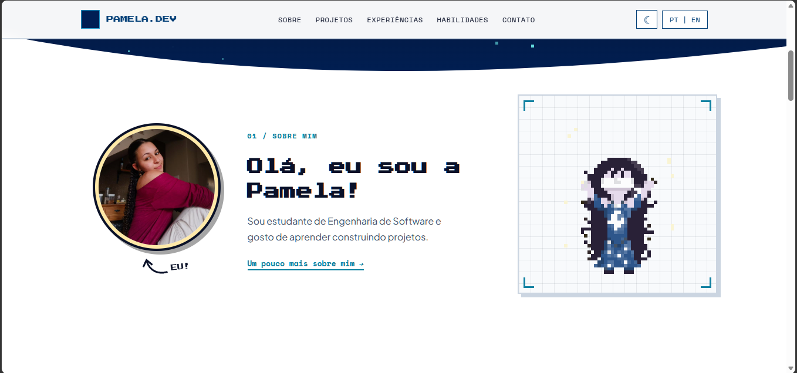

**Projetos**
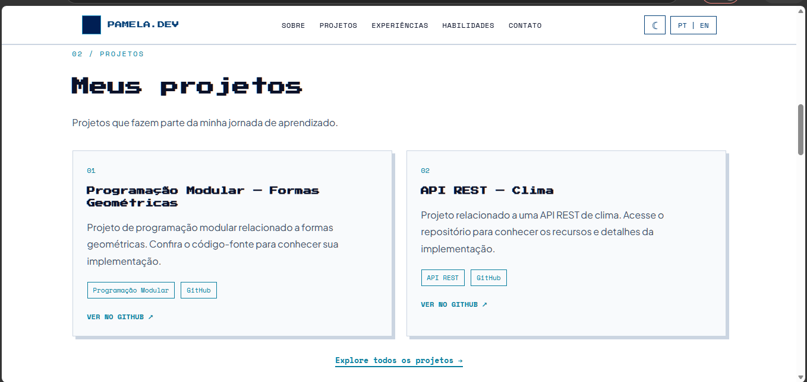

**Experiências**
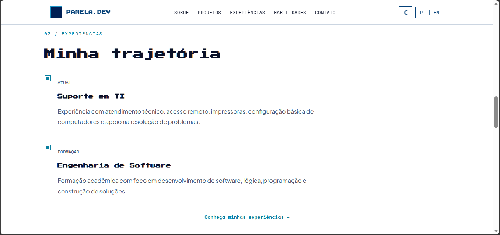

**Habilidades**
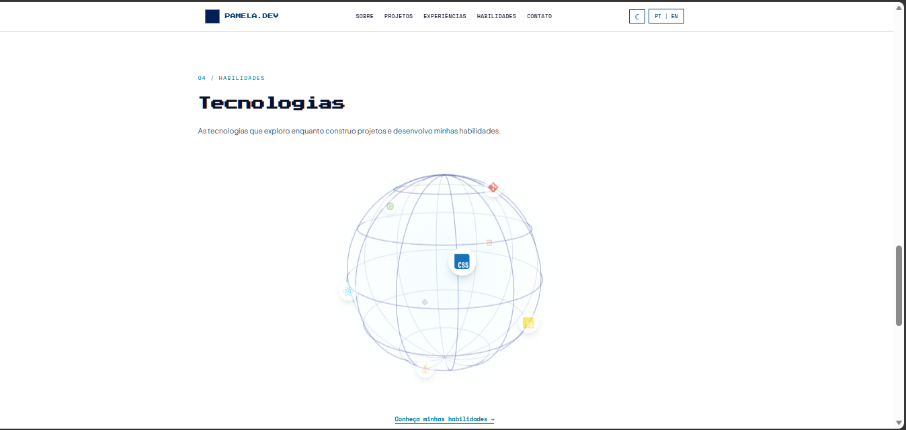

**Contato**
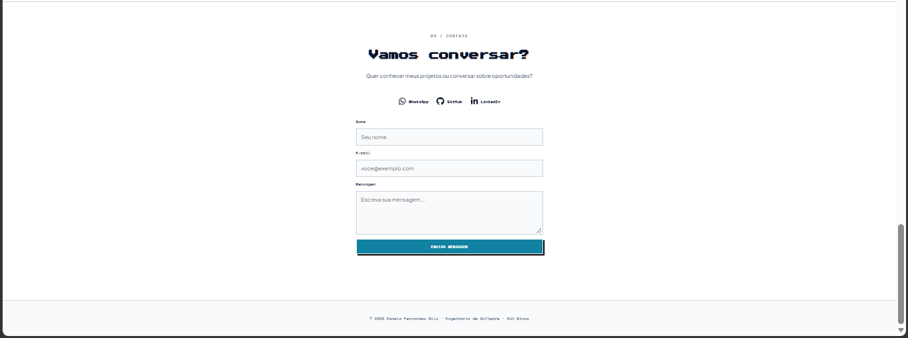

### Páginas internas

**/projetos**
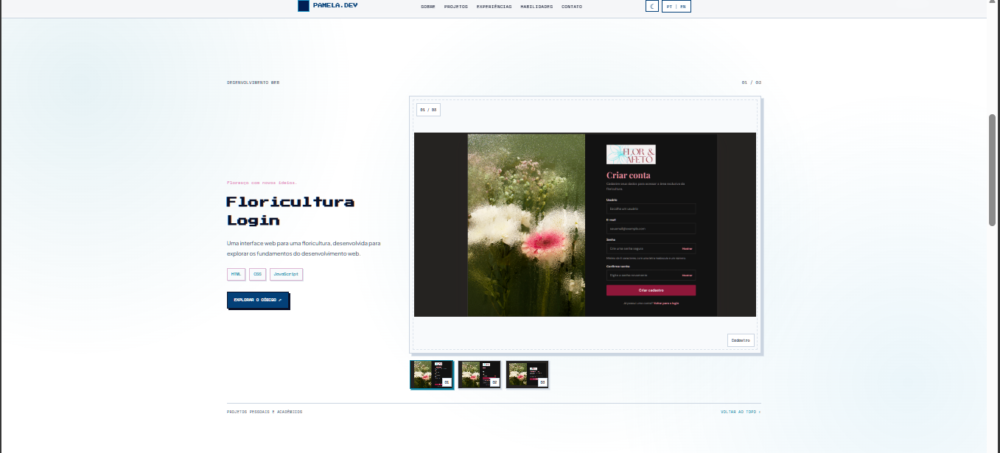

**/sobre**
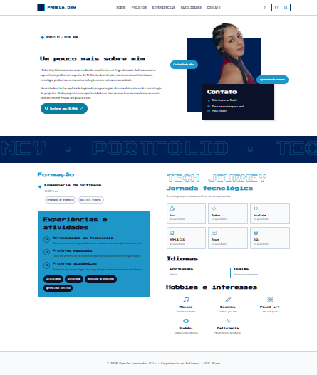

**/experiencias**
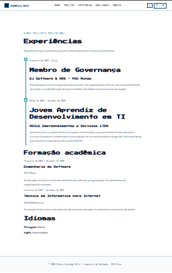

---

## 🛠️ Tecnologias utilizadas

- **React** — biblioteca JavaScript que monta a interface a partir de componentes reutilizáveis
- **Vite** — ferramenta que roda o projeto durante o desenvolvimento e gera a versão final (build)
- **React Router** — controla a navegação entre as páginas (`/`, `/sobre`, `/projetos`, `/experiencias`) sem recarregar o site
- **CSS puro** — toda a estilização feita à mão, sem framework de CSS
- **Three.js + React Three Fiber** — criam o globo 3D interativo da seção de habilidades
- **EmailJS** — serviço que envia o e-mail do formulário de contato direto do navegador, sem back-end próprio
- **Vercel** — hospedagem gratuita na nuvem
- **Git e GitHub** — controle de versão e repositório
- **Figma** — wireframes e protótipos

---

## 📦 Dependências e bibliotecas

**Produção** (`dependencies`)

| Pacote | Versão | Para que serve |
|---|---|---|
| `react` | ^19.2.8 | Biblioteca principal da interface |
| `react-dom` | ^19.2.8 | Desenha os componentes React no navegador |
| `react-router-dom` | ^7.18.4 | Rotas e navegação entre páginas |
| `@emailjs/browser` | ^5.0.3 | Envio do formulário de contato por e-mail |
| `three` | ^0.186.1 | Motor de gráficos 3D |
| `@react-three/fiber` | ^9.8.1 | Permite usar o Three.js dentro de componentes React |
| `@react-three/drei` | ^10.7.9 | Ferramentas prontas para cenas 3D (câmera, controles, etc.) |
| `react-icons` | ^5.7.0 | Ícones (WhatsApp, GitHub, LinkedIn, tecnologias) |
| `bootstrap-icons` | ^1.13.2 | Ícones usados na página Sobre |

**Desenvolvimento** (`devDependencies`)

| Pacote | Versão | Para que serve |
|---|---|---|
| `vite` | ^8.3.0 | Servidor de desenvolvimento e build |
| `@vitejs/plugin-react` | ^6.1.1 | Faz o Vite entender React |
| `eslint` | ^10.10.0 | Aponta erros e padroniza o código |
| `@eslint/js`, `eslint-plugin-react-hooks`, `eslint-plugin-react-refresh`, `globals` | — | Regras e configurações do ESLint |
| `@types/react`, `@types/react-dom` | — | Tipos para autocompletar no editor |

---

## 📁 Estrutura de diretórios

```
portofilio_web/
├── frontend/
│   ├── public/
│   │   ├── images/                 # foto de perfil
│   │   └── projetos/               # imagens e GIFs dos projetos
│   │       ├── floricultura/
│   │       ├── pygame/
│   │       └── ia/
│   ├── src/
│   │   ├── assets/                 # foto-perfil.jpg, luna-animada.gif
│   │   ├── components/             # Header, Footer, Layout, StarField, Luna,
│   │   │                           # SobreResumo, SkillsGlobe, ContactForm
│   │   ├── context/                # IdiomaContext.jsx (PT/EN)
│   │   ├── data/                   # skills.js
│   │   ├── hooks/                  # useReveal.js (animação ao rolar)
│   │   ├── pages/                  # Home, Sobre, Projetos, Experiencias
│   │   ├── App.jsx                 # rotas
│   │   ├── main.jsx
│   │   └── index.css
│   ├── index.html
│   ├── package.json
│   └── vite.config.js
├── docs/
│   ├── screenshots/                # prints do site
│   └── wireframes/                 # wireframes das páginas
└── README.md
```

---

## ▶️ Como executar localmente

**Pré-requisitos:** [Node.js](https://nodejs.org/) 20.19 ou superior, npm e Git.

```bash
# 1. Clonar o repositório
git clone https://github.com/pamelanilo/SEU-REPOSITORIO.git
cd SEU-REPOSITORIO/frontend

# 2. Instalar as dependências
npm install

# 3. Criar o arquivo .env (veja abaixo)

# 4. Rodar em modo de desenvolvimento
npm run dev
# abre em http://localhost:5173
```

**Outros comandos**

```bash
npm run build     # gera a versão final na pasta dist/
npm run preview   # testa localmente a versão final
npm run lint      # verifica o código com o ESLint
```

**Variáveis de ambiente** — crie `frontend/.env` com as chaves da sua conta no [EmailJS](https://www.emailjs.com/):

```
VITE_EMAILJS_SERVICE_ID=seu_service_id
VITE_EMAILJS_TEMPLATE_ID=seu_template_id
VITE_EMAILJS_PUBLIC_KEY=sua_public_key
VITE_EMAILJS_AUTOREPLY_TEMPLATE_ID=seu_template_de_resposta_automatica
```

---

## ☁️ Deploy

Hospedado na **Vercel**, conectado ao GitHub. Configuração usada:

- **Root Directory:** `frontend`
- **Build Command:** `npm run build`
- **Output Directory:** `dist`
- **Variáveis de ambiente:** as quatro `VITE_EMAILJS_*` cadastradas no painel da Vercel

A cada `push` na branch principal, a Vercel publica uma nova versão.

---

## ✅ Funcionalidades

- [x] Menu de navegação fixo com links para cada seção
- [x] Alternância de idioma **PT | EN** em todo o site
- [x] Tema claro e escuro
- [x] **Sobre mim** resumido na Home e página completa em `/sobre`
- [x] **Projetos** com descrição, tecnologias, link do GitHub e galeria de imagens/GIFs
- [x] **Experiências** em linha do tempo, com formação e idiomas
- [x] **Habilidades** em globo 3D interativo
- [x] **Contato** com ícones clicáveis (WhatsApp, GitHub, LinkedIn) e formulário com envio por e-mail
- [x] Validação dos campos obrigatórios e mensagem de erro no envio
- [x] Design responsivo
- [x] Animações em pixel art (Luna) e campo de estrelas no hero
- [x] Publicado na nuvem

---

## 🗓️ Processo de desenvolvimento

| Sprint | Entrega |
|---|---|
| **S01** | Repositório e README inicial, wireframes, protótipo do front-end, navegação e layout base |
| **S02** | Páginas Sobre, Projetos, Experiências e Contato, com idiomas, formulário e responsividade |
| **S03** | Deploy na Vercel, ajustes visuais, imagens/GIFs dos projetos e README final |

---

## 🎨 Decisões de design e arquitetura

- **Identidade visual:** pixel art e céu noturno, com a Luna como marca pessoal
- **Arquitetura:** site de página única com rotas (React Router), componentes reutilizáveis e textos em dois idiomas controlados por um contexto de idioma
- **Sem back-end próprio:** o envio de e-mail usa o EmailJS, o que simplifica a hospedagem
- **Navegação evidente:** menu fixo no topo, com seletor de tema e de idioma sempre à vista

---

## 👩‍💻 Autora

**Pamela Fernandes Nilo** — Engenharia de Software, PUC Minas